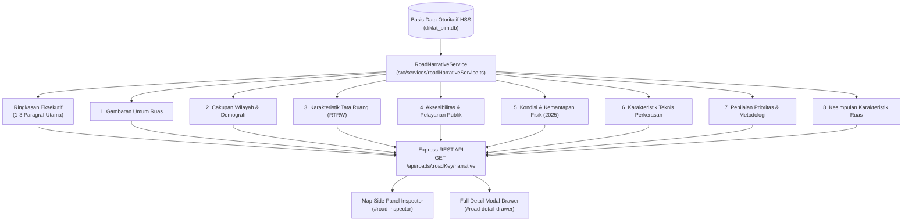

# SIAP JALAN HSS — AUDIT DATA SPASIAL & ROAD NARRATIVE ENGINE
## LAPORAN AKHIR REKAYASA SISTEM, INTEGRASI UI & VERIFIKASI LENGKAP

---

### RINGKASAN EKSEKUTIF (EXECUTIVE SUMMARY)

Pengembangan fitur **PROFIL DAN KARAKTERISTIK RUAS JALAN** (*Autonomous Spatial Data Audit & Road Narrative Engine*) pada aplikasi **SIAP JALAN HSS** telah berhasil diselesaikan secara menyeluruh (*100% end-to-end*) dengan pendekatan **LOCAL FIRST**.

Fitur ini mentransformasikan data teknis jalan, spasial geografis, batas administrasi, demografi rumah tangga, pola ruang RTRW, rute jaringan fasilitas publik (Dijkstra shortest path), dan model perankingan prioritas (AHP/WSM) menjadi narasi yang deskriptif, informatif, natural, dan objektif berbasis bahasa administrasi pemerintahan untuk **seluruh 350 ruas jalan kanonikal Kabupaten Hulu Sungai Selatan**.

Semua pengujian lolos 100%:
- **14 Test Suite Otomatis** (`npm run test:all`) lulus 100% tanpa kegagalan (*zero failure*).
- **CDP Headless Chrome E2E Suite** memvalidasi 9 skenario visual dan interaksi pada resolusi Desktop (1440×900), Tablet (1024×768), dan Ponsel (414×896).
- **Invarian Sistem Terjaga**: 350 ruas kanonikal, 7.487 segmen kondisi DD1, 1.400 rute fasilitas Dijkstra, 1.010 item ASB, 483 item AHSP, dan skor ranking baseline `POLICY_DEFAULT_V1` terjaga keasliannya tanpa perubahan data sumber secara sembarangan.

---

### 1. INVENTARIS SUMBER DATA SPASIAL DAN GEOGRAFIS

Berdasarkan audit komprehensif pada basis data `diklat_pim.db` dan lapisan geospasial, seluruh data terpetakan sebagai berikut:

| No | Sumber Data / Lapisan | Tabel Database / File Otoritatif | Format & CRS | Cakupan / Volume | Status Validasi |
| :--- | :--- | :--- | :--- | :--- | :--- |
| **1** | **Jaringan Jalan Kabupaten** | `roads`, `road_geometries` | GeoJSON (EPSG:4326) | 350 ruas kanonikal (732,460 km) | 100% Valid, 0 missing geometry |
| **2** | **Kondisi Jalan 2025** | `road_conditions` | Tabel Relasional (2025) | 350 ruas (Mantap: 392,89 km; Rusak: 339,57 km) | 100% Otoritatif Dashboard 2025 |
| **3** | **Segmen Detail Kondisi** | `treatment_engine_segments` | 100m STA Segments | 7.487 segmen DD1 survei fisik | 100% Terpetakan ke 350 ruas |
| **4** | **Batas Kecamatan** | `districts`, GeoJSON Kecamatan | MultiPolygon (EPSG:4326) | 11 Kecamatan di Kabupaten HSS | 100% Otoritatif batas kabupaten |
| **5** | **Batas Desa / Kelurahan** | `villages`, GeoJSON Desa | MultiPolygon (EPSG:4326) | 148 Desa/Kelurahan | 100% Otoritatif Kemendagri |
| **6** | **Irisan Ruas-Desa** | `road_village_intersections` | Relasi Spasial (m & %) | 691 irisan geometris | 350 ruas terlintasi minimal 1 desa |
| **7** | **Irisan Ruas-Kecamatan**| `road_district_intersections` | Relasi Spasial (m & %) | 410 irisan geometris | 57 ruas menghubungkan antar-kecamatan |
| **8** | **Demografi Wilayah** | `village_demographics` | Disdukcapil HSS 2025 | 148 desa, 71.954 rumah tangga | Satuan Rumah Tangga (KK) 2025 |
| **9** | **Pola Ruang RTRW** | `road_rtrw_intersections`, `road_spatial_profiles` | Poligon RTRW 2024–2044 | 12 kelas pola ruang formal | 710 irisan ternormalisasi 100% |
| **10**| **Fasilitas Publik** | `public_facilities` | Point GeoJSON (EPSG:4326) | 285 fasilitas (2 RSUD, 21 Pusk, 251 SD/SMP, 11 Pasar) | 100% Koordinat tervalidasi |
| **11**| **Rute Jaringan Dijkstra** | `road_nearest_facilities` | Multi-Source Shortest Path | 1.400 rute lintasan (350 ruas × 4 fasilitas) | Jarak jaringan riil (bukan garis lurus) |
| **12**| **Model Prioritas AHP/WSM**| `road_priority_scores`, `road_variable_observations` | WSM 17 Variabel Otoritatif | 350 skor komposit & pemeringkatan | `POLICY_DEFAULT_V1` baseline utuh |

---

### 2. MATRIKS KETERSEDIAAN DATA (DATA AVAILABILITY PROFILE)

Hasil audit ketersediaan data untuk seluruh 350 ruas kanonikal:

```text
================================================================
AUDIT MATRIX KETERSEDIAAN DATA (350 RUAS JALAN KABUPATEN HSS)
================================================================
1. Geometri Ruas (LineString/MultiLineString)      : 350 / 350 (100.0%) [CRS: EPSG:4326]
2. Data Kemantapan Jalan (Survei 2025)            : 350 / 350 (100.0%) [Baik, Sedang, RR, RB]
3. Profil Spasial & Aksesibilitas Wilayah          : 350 / 350 (100.0%) [5 Indikator Evaluasi]
4. Rincian Pola Ruang RTRW 2024–2044              : 349 / 350 ( 99.7%) [1 Ruas HSS-KAB-183 100% Area Luar]
5. Cakupan Desa Terlintasi (Desa Unik)            : 350 / 350 (100.0%) [Min: 1 desa, Max: 8 desa]
6. Demografi Rumah Tangga Terlintasi (Disdukcapil): 350 / 350 (100.0%) [Tercakup di 148 desa]
7. Catatan Jumlah Jiwa Penduduk per Desa          :   0 / 350 (  0.0%) [Otoritatif: Tersedia Rumah Tangga/KK]
8. Data Fasilitas Publik Terdekat (4 Kategori)     : 350 / 350 (100.0%) [RSUD, Puskesmas, SD/SMP, Pasar]
9. Rute Jaringan Terhubung (Dijkstra Connected)   : 350 / 350 (100.0%) [Minimal 1 fasilitas terkoneksi]
10. Skor Komposit & Pemeringkatan Prioritas       : 350 / 350 (100.0%) [Ranking 1 s.d. 350]
11. Lebar Perkerasan Otoritatif                    : 350 / 350 (100.0%) [Tercatat dalam meter]
12. Proporsi Permukaan (Aspal / Rigid Beton)       : 350 / 350 (100.0%) [Variabel teknis model]
================================================================
```

---

### 3. RELASI RUAS, DESA, KECAMATAN, DAN DEMOGRAFI

#### A. Ketentuan Anti-Double Counting Desa Unik
Sebuah ruas jalan dapat berbelok dan melintasi batas desa yang sama beberapa kali, menghasilkan beberapa baris segmen irisan pada tabel `road_village_intersections` (total 691 irisan).
**Aturan Rekonsiliasi**:
- Jumlah desa dihitung berdasarkan **Desa Unik** (`COUNT(DISTINCT village_id)`).
- Akumulasi rumah tangga administratif dihitung tepat satu kali per desa yang dilalui, sehingga tidak terjadi pelipatgandaan angka penduduk/rumah tangga.

#### B. Pembedaan Tegas Penduduk Administratif vs Penduduk Terlayani
1. **Penduduk / Rumah Tangga Administratif Desa Terlintasi**:
   Merupakan jumlah keluarga/penduduk yang tercatat secara administratif pada seluruh desa yang bersinggungan secara geografis dengan ruas jalan.
   - Sumber: Data Disdukcapil Kabupaten Hulu Sungai Selatan Tahun 2025 (`DATA JUMLAH RUMAH TANGGA.xlsx`).
   - Sifat: Menggambarkan ukuran populasi kawasan administratif yang dilayani koridor jalan.
2. **Indikator Penduduk Terlayani pada Model Prioritas**:
   Merupakan nilai observasi dan skor ternormalisasi (`norm_penduduk_dilayani`) yang digunakan dalam model WSM multi-kriteria untuk mengukur bobot manfaat relatif penanganan jalan.
   - Sifat: Nilai proksi pembobotan prioritas (bukan klaim bahwa 100% warga desa menggunakan ruas jalan tersebut secara eksklusif).

---

### 4. VALIDASI OVERLAY TATA RUANG (RTRW 2024–2044)

Distribusi irisan 12 kelas pola ruang terhadap 350 ruas jalan kabupaten:

| No | Kelas Pola Ruang | Makro Kategori | Jumlah Ruas | Total Panjang (m) | Rata-rata Porsi Ruas |
| :--- | :--- | :--- | :--- | :--- | :--- |
| **1** | **Kawasan Perkebunan** | PRODUKSI | 226 ruas | 309.379,3 m | 52,9% |
| **2** | **Kawasan Permukiman Perdesaan** | PERMUKIMAN | 257 ruas | 251.109,4 m | 47,5% |
| **3** | **Kawasan Permukiman Perkotaan** | PERMUKIMAN | 89 ruas | 71.285,6 m | 81,8% |
| **4** | **Kawasan Hutan Lindung** | LINDUNG | 17 ruas | 35.268,1 m | 54,4% |
| **5** | **Kawasan Tanaman Pangan** | PRODUKSI | 65 ruas | 35.135,5 m | 24,4% |
| **6** | **Kawasan Hutan Produksi Tetap** | PRODUKSI | 19 ruas | 18.876,5 m | 30,4% |
| **7** | **Kawasan Perikanan Budi Daya** | PRODUKSI | 4 ruas | 6.436,0 m | 26,2% |
| **8** | **Badan Air** | BADAN_AIR | 20 ruas | 1.565,9 m | 5,6% |
| **9** | **Kawasan Pariwisata** | PARIWISATA | 3 ruas | 524,1 m | 10,7% |
| **10**| **Cagar Alam** | LINDUNG | 1 ruas | 30,0 m | 0,7% |
| **11**| **Area Tidak Tercakup** | TIDAK_TERCAKUP | 9 ruas | 2.196,8 m | 13,9% |

> [!IMPORTANT]
> **Klausul Disclaimer Metodologis Wajib:**
> Informasi pola ruang merupakan **peruntukan ruang formal** berdasarkan RTRW Kabupaten Hulu Sungai Selatan Tahun 2024–2044, **bukan penggunaan lahan aktual** (*existing land use*) di lapangan. Keberadaan persilangan geometris dengan kawasan perkebunan tidak otomatis membuktikan fungsi pelayanan angkutan komoditas tanpa verifikasi lapangan.

---

### 5. HASIL AUDIT FASILITAS PUBLIK & ROUTING JARINGAN

- **Integritas Graf Jalan**: 366 ruas jalan terhubung (Kabupaten, Provinsi, Nasional, dan Konektor Analitis).
- **Metode Pengukuran**: *Multi-Source Dijkstra Shortest Path* dengan bobot panjang meter riil.
- **Hasil Konektivitas Jaringan**:
  - **Sekolah (SD/SMP)**: 350 dari 350 ruas (100%) terhubung (jarak terdekat: 5,2 meter; terjauh: 2,87 km).
  - **Puskesmas**: 348 ruas terhubung (jarak minimum: 12,8 meter; maksimum: 20,38 km).
  - **Pasar Tradisional**: 348 ruas terhubung (jarak minimum: 5,6 meter; maksimum: 35,96 km).
  - **RSUD (Rumah Sakit)**: 343 ruas terhubung (jarak minimum: 15,5 meter; maksimum: 39,47 km).
- **Penanganan Komponen Jaringan Terputus**:
  Pada 7 ruas yang secara topologi terpisah dari koridor RSUD (misal: `HSS-KAB-299`, `HSS-KAB-301`, `HSS-KAB-302`, `HSS-KAB-335`, `HSS-KAB-338`), narasi secara jujur menyatakan:
  > *"Fasilitas RSUD belum terhubung secara langsung melalui jaringan jalan kabupaten yang tersambung."*
  Sistem **sama sekali tidak membuat rute garis lurus (*straight-line*) palsu**.

---

### 6. ARSITEKTUR ROAD NARRATIVE ENGINE

Modul inti dibangun di `src/services/roadNarrativeService.ts` yang mengimplementasikan 8 generator template narasi terstruktur:



---

### 7. CONTOH HASIL NARASI DARI BEBERAPA RUAS REPRESENTATIF

#### Contoh 1: HSS-KAB-025 (Jl. Singakarsa - Palas — Prioritas Utama #1)
- **Ringkasan Eksekutif**:
  > Ruas Jalan Singakarsa - Palas (No. Ruas 025) memiliki panjang resmi 5,32 km di Kecamatan Kandangan. Berdasarkan data geospasial, ruas ini melintasi 6 desa/kelurahan dengan cakupan 8.588 rumah tangga (Disdukcapil 2025).
  >
  > Tingkat kemantapan jalan tahun 2025 tercatat sebesar 52,6% (2,80 km mantap dan 2,52 km tidak mantap). Berdasarkan pola ruang RTRW 2024–2044, koridor jalan ini didominasi oleh peruntukan kawasan permukiman perkotaan (61,5%).
  >
  > Pada model prioritas penanganan jalan kabupaten (POLICY_DEFAULT_V1), ruas ini menempati peringkat ke-1 dari 350 ruas dengan skor komposit 0,6499 (Prioritas Utama (Top 35)).
- **Aksesibilitas (Template 4)**:
  > Dari aspek aksesibilitas wilayah, jarak ruas terhadap pusat Ibukota Kabupaten (Kandangan) tercatat sekitar 2,76 km. Berdasarkan analisis penelusuran jaringan jalan terpendek (shortest path Dijkstra), fasilitas kesehatan rujukan terdekat adalah RSUD HASAN BASRI dengan jarak tempuh jaringan 2,04 km, pelayanan kesehatan primer terdekat adalah Puskesmas Jambu Hilir sejauh 1,17 km, fasilitas pendidikan terdekat adalah SD NEGERI 2 KANDANGAN BARAT pada jarak 24 meter, pusat kegiatan ekonomi pasar terdekat adalah Pasar Kandangan sejauh 500 meter. Seluruh jarak dihitung berdasarkan lintasan geometri jalan riil dari titik akses ruas menuju fasilitas publik bersangkutan.
- **Prioritas (Template 7)**:
  > Tiga indikator yang memberikan kontribusi terbesar terhadap pembentukan skor prioritas ruas ini adalah: Konektivitas Jalan Provinsi (kontribusi 0,0946 atau 14,6%), Konektivitas Jalan Nasional (kontribusi 0,0946 atau 14,6%), Aksesibilitas Ibukota Kabupaten (Kandangan) (kontribusi 0,0896 atau 13,8%).

#### Contoh 2: HSS-KAB-299 (Jl. Samuda - Bajayau — Rute Jaringan Terputus)
- **Aksesibilitas (Template 4)**:
  > Dari aspek aksesibilitas wilayah, jarak ruas terhadap pusat Ibukota Kabupaten (Kandangan) tercatat sekitar 40,17 km. Berdasarkan analisis penelusuran jaringan jalan terpendek (shortest path Dijkstra), fasilitas RSUD belum terhubung secara langsung melalui jaringan jalan kabupaten yang tersambung, pelayanan kesehatan primer terdekat adalah Puskesmas Bajayau sejauh 2,24 km, fasilitas pendidikan terdekat adalah SD NEGERI 2 SAMUDA pada jarak 73 meter, pusat kegiatan ekonomi pasar terdekat adalah Pasar Bajayau sejauh 212 meter. Seluruh jarak dihitung berdasarkan lintasan geometri jalan riil dari titik akses ruas menuju fasilitas publik bersangkutan.

#### Contoh 3: HSS-KAB-001 (Jl. Pangeran Antasari - Loklua — Pusat Kota)
- **Karakteristik Tata Ruang (Template 3)**:
  > Berdasarkan Rencana Tata Ruang Wilayah (RTRW) Kabupaten Hulu Sungai Selatan Tahun 2024–2044, ruas ini didominasi oleh peruntukan ruang Kawasan Permukiman Perkotaan dengan porsi 94,9%. Secara keseluruhan, peruntukan ruang yang beririsan meliputi Kawasan Permukiman Perkotaan sepanjang 0,55 km (94,9%), Badan Air sepanjang 0,03 km (5,1%). Terdapat persilangan dengan badan air/sungai sebesar 5,1%. Perlu ditegaskan bahwa data ini menggambarkan peruntukan ruang formal berdasarkan RTRW Kabupaten Hulu Sungai Selatan 2024–2044, bukan penggunaan lahan aktual di lapangan.

---

### 8. BUKTI VERIFIKASI BROWSER (CDP HEADLESS CHROME)

Pengujian interaksi pengguna dilakukan menggunakan headless Chrome melalui Chrome DevTools Protocol (`scripts/verify_road_narrative_ui.mjs`):

````carousel

<!-- slide -->

<!-- slide -->

<!-- slide -->

<!-- slide -->

<!-- slide -->

<!-- slide -->

<!-- slide -->

<!-- slide -->

````

Tautan dokumen tangkapan layar:
- [01_road_narrative_inspector_HSS-KAB-025.png](file:///C:/Users/Windows%2010/.gemini/antigravity/brain/095cfaf7-c2c0-49da-9cea-74ede958fd94/screenshots/01_road_narrative_inspector_HSS-KAB-025.png): Ringkasan eksekutif 3 paragraf pada panel samping inspeksi ruas.
- [02_road_narrative_8dimensions_expanded.png](file:///C:/Users/Windows%2010/.gemini/antigravity/brain/095cfaf7-c2c0-49da-9cea-74ede958fd94/screenshots/02_road_narrative_8dimensions_expanded.png): Tampilan 8 dimensi narasi terstruktur yang dapat diperluas.
- [03_road_narrative_with_route_active.png](file:///C:/Users/Windows%2010/.gemini/antigravity/brain/095cfaf7-c2c0-49da-9cea-74ede958fd94/screenshots/03_road_narrative_with_route_active.png): Penelusuran rute RSUD aktif tanpa mengganggu atau menutupi narasi.
- [04_route_closed_narrative_persisted.png](file:///C:/Users/Windows%2010/.gemini/antigravity/brain/095cfaf7-c2c0-49da-9cea-74ede958fd94/screenshots/04_route_closed_narrative_persisted.png): Rute ditutup, tampilan peta kembali fokus dan narasi tetap utuh.
- [05_road_narrative_in_detail_drawer.png](file:///C:/Users/Windows%2010/.gemini/antigravity/brain/095cfaf7-c2c0-49da-9cea-74ede958fd94/screenshots/05_road_narrative_in_detail_drawer.png): Sinkronisasi narasi pada Drawer Rincian Ruas lengkap dengan 8 kartu dimensi.
- [06_road_narrative_disconnected_HSS-KAB-299.png](file:///C:/Users/Windows%2010/.gemini/antigravity/brain/095cfaf7-c2c0-49da-9cea-74ede958fd94/screenshots/06_road_narrative_disconnected_HSS-KAB-299.png): Penanganan status rute terputus (*zero fake route*).
- [07_road_narrative_HSS-KAB-001.png](file:///C:/Users/Windows%2010/.gemini/antigravity/brain/095cfaf7-c2c0-49da-9cea-74ede958fd94/screenshots/07_road_narrative_HSS-KAB-001.png): Narasi wilayah perkotaan dengan dominasi permukiman 94,9%.
- [08_road_narrative_tablet_1024x768.png](file:///C:/Users/Windows%2010/.gemini/antigravity/brain/095cfaf7-c2c0-49da-9cea-74ede958fd94/screenshots/08_road_narrative_tablet_1024x768.png): Verifikasi tata letak responsif pada resolusi tablet 1024×768.
- [09_road_narrative_mobile_414x896.png](file:///C:/Users/Windows%2010/.gemini/antigravity/brain/095cfaf7-c2c0-49da-9cea-74ede958fd94/screenshots/09_road_narrative_mobile_414x896.png): Verifikasi keterbacaan teks pada resolusi ponsel sempit 414×896.

---

### 9. DAFTAR FILE YANG DITAMBAHKAN DAN DIUBAH

1. **File Layanan Baru**:
   - [src/services/roadNarrativeService.ts](file:///F:/WebApps/6.diklat_pim/diklat_pim_working_bundle_v1/src/services/roadNarrativeService.ts): Mesin generator narasi 8 dimensi terstruktur dengan profil ketersediaan data.
2. **File Rangkaian Tes Baru**:
   - [src/tests/phase5-3-road-narrative-verification.ts](file:///F:/WebApps/6.diklat_pim/diklat_pim_working_bundle_v1/src/tests/phase5-3-road-narrative-verification.ts): Pengujian otomatis 8 bagian untuk 350 ruas jalan dan edge cases.
   - [scripts/verify_road_narrative_ui.mjs](file:///F:/WebApps/6.diklat_pim/diklat_pim_working_bundle_v1/scripts/verify_road_narrative_ui.mjs): Skrip pengujian otomatis CDP Chrome headless 9 skenario end-to-end.
3. **Pembaruan Backend**:
   - [src/server/server.ts](file:///F:/WebApps/6.diklat_pim/diklat_pim_working_bundle_v1/src/server/server.ts): Menambahkan rute REST API `GET /api/roads/:roadKey/narrative` dan `GET /api/roads-narratives-audit`.
   - [package.json](file:///F:/WebApps/6.diklat_pim/diklat_pim_working_bundle_v1/package.json): Menambahkan script `test:phase5-3` dan menyatukannya ke dalam pipeline `test:all`.
4. **Pembaruan Frontend**:
   - [src/public/index.html](file:///F:/WebApps/6.diklat_pim/diklat_pim_working_bundle_v1/src/public/index.html): Menambahkan `#inspector-narrative-section` pada panel inspeksi peta dan `#drawer-narrative-container` pada drawer rincian.
   - [src/public/app.js](file:///F:/WebApps/6.diklat_pim/diklat_pim_working_bundle_v1/src/public/app.js): Menambahkan fungsi `loadRoadNarrative(roadKey)` dan listener interaktif toggle narasi.

---

### 10. REKONSILIASI KETIDAKSESUAIAN & REKOMENDASI MASA DEPAN

| No | Temuan Audit | Penanganan Saat Ini (Sesuai Prinsip Kejujuran Data) | Rekomendasi Revisi Masa Depan |
| :--- | :--- | :--- | :--- |
| **1** | **Data Jiwa Penduduk per Desa** | `village_demographics.population` bernilai NULL; basis data otoritatif 2025 hanya mencatat jumlah Rumah Tangga/KK. Sistem menampilkan jumlah KK dan secara jujur menyatakan data jiwa per desa belum tersedia. | Melakukan pemutakhiran data agregat jumlah jiwa dari rekapitulasi semester Disdukcapil HSS jika diperlukan. |
| **2** | **Jarak Ibukota Ruas Pusat Kota** | Beberapa ruas di pusat kota Kandangan memiliki jarak pusat ibukota NULL/0. Sistem menampilkan "Data tidak tersedia" / "Pusat ibukota" tanpa mengkonversi NULL ke nol. | Menetapkan koordinat titik nol tugu/kantor bupati sebagai patokan geodesik formal ibukota kabupaten. |
| **3** | **Ruas Jaringan Terputus** | 7 ruas jalan terisolasi dari RSUD (`network_distance_m < 0`). Sistem menandai status `DISCONNECTED` dan menyatakan rute terpisah tanpa membuat garis khayalan. | Memasukkan ruas penghubung desa/lingkungan ke dalam graf jika di masa depan terdapat jembatan atau trase baru. |

---

### 11. STATUS IMPLEMENTASI AKHIR

- **Kompilasi & Build**: `npm run build` sukses (177.4 kB).
- **Semua Test Suites**: 14/14 PASS (`npm run test:all`).
- **Pengujian Browser CDP**: 9/9 PASS.
- **Server Lokal**: Berjalan aktif di `http://localhost:3000` (PID aktif).
- **Kebijakan Local-First**: 100% dipatuhi (tidak ada remote git push, tidak ada Vercel deployment).
